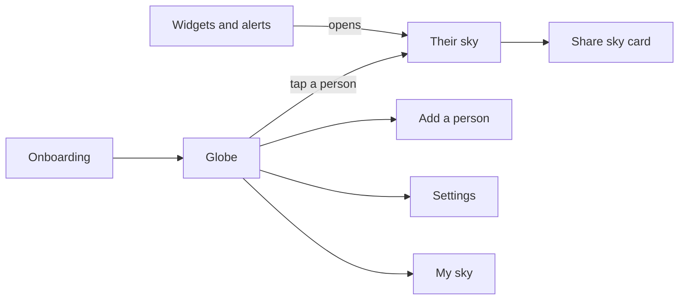
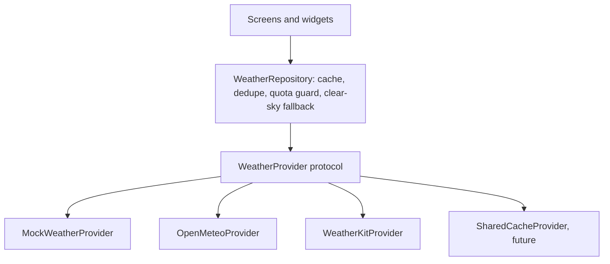
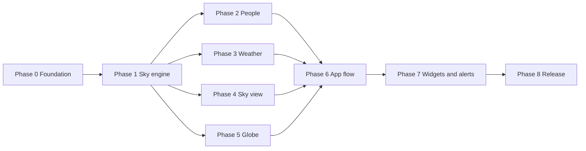
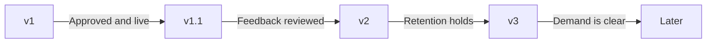

# Hello Sky: Product and SwiftUI Build Plan

Last updated 2026-10-22, with all planning decisions applied. This file merges the v1 product draft and the SwiftUI build plan into one document. Every v1 feature is assigned to a build phase, so the app is complete when the last phase is done.

**How to use it:** build the phases in order (phases 2 to 5 can be done in any order). Do not start the next phase until the current phase meets its "Done when" line. Each phase is runnable and testable on its own.

---

## 0. Decisions made

| Decision | Choice | Notes |
| --- | --- | --- |
| Name | Hello Sky | Checked and available. It stays unreserved until the app record exists in App Store Connect, so reserve it after the first real progress milestone |
| Minimum iOS | 27 | Latest iOS only. This is a deliberate choice to keep one code path: Liquid Glass styling and on-device AI captions are available unconditionally, with no runtime fallbacks to maintain |
| Globe | RealityKit | Phase 5 opens with a spike; a Metal view is the fallback only if the spike fails |
| Weather | Open-Meteo while developing, WeatherKit for release | **Important:** all weather goes through a provider layer and a repository layer (section 6), so switching sources or adding a cache never touches screens |
| Widgets on a free Apple ID | Not possible: App Groups are unavailable | Build widgets with sample data; enroll in the paid program before Phase 7 to share real data |
| Languages | English only at launch | Keep all text in a String Catalog so more languages can be added later without code changes |
| Looks | All three ship in v1 | The look system is data-driven so more looks (for example a storybook style) can be added later |
| Developer account | Enroll as an individual before Phase 7 | Needed for widget data sharing (App Groups), WeatherKit, and TestFlight |
| People avatars | Emoji only in v1 | Photos come in v2; the model stores an avatar type so no data migration is needed |
| "You" location | Typed home city, with optional device location | |
| Test devices | iPhone 12 Pro on iOS 27 is the performance baseline | Owned and available. iOS 27 reaches back to the iPhone 12 generation, so quality tiers still matter for anything older |
| Older iPhones | Automatic quality tiers | Texture size, clouds, and glow drop when the frame rate drops, so phones that cannot be tested still run well |
| Glass styling | `glassEffect` everywhere | No `Material` fallback needed at an iOS 27 minimum |
| Clouds | Live Cloud Maps snapshot bundled in the app | Public-domain images; credit "Contains modified EUMETSAT data" |
| Credits | Apple Weather mark and legal link inside the app; other credits in the app’s credits screen and on the website | See "Credits and attribution" in section 6 |
| Privacy policy and support pages | Built on your own website after the app is ready | Must be live before submission in Phase 8 |
| App icon | Built first with Claude Code | Replace with designer work only if the result is not good enough |

No planning questions remain open. Section 13 lists tasks that happen later.

---

## 1. Vision

Hello Sky is a free iPhone app that shows the sky where the people you care about are, right now.

You open a globe with your people on it. Tap one, and the whole screen becomes their live sky: real colors, clouds, moon, and local time. A world clock says it is 7:40 AM; this shows a clear, golden morning at Mom’s.

**Why it can attract people:** the signature zoom makes a 15-second demo clip, the sky cards are easy to share, and the widgets keep it on the Home Screen.

**Why it works as a showcase:** one small product combines 3D rendering, shaders, astronomy math, and WidgetKit.

Hello Sky is the chosen name and it is available. Reserve it in App Store Connect once there is real progress (see section 13).

**Reference:** the interactive web demo (single HTML file) is the visual and behavior reference. Its JavaScript astronomy code is the source to port in Phase 1.

## 2. Who it is for

The core user has people in other time zones: family abroad, friends who moved, a partner or colleague far away. Sky-watchers and photographers are a secondary audience who will use "My sky" daily.

Four moments bring them back:

- **Before a call:** a quick look at whether it is a good time to call.
- **A glance at the Home Screen:** a widget showing a person’s local time on their real sky.
- **A sunrise or sunset alert:** "Sunset starts at Dad’s in 15 minutes."
- **Sharing:** posting a sky card to Stories or sending it to the person it shows.

## 3. The signature moment

Tapping a person on the globe turns the whole screen into their live sky in about 1.5 seconds. This is the demo clip, the App Store preview, and the reason someone installs the app; everything else supports it.

1. The globe rotates and zooms smoothly to the person’s city.
2. The globe fades into their sky, colored by their real sun position, clouds, and moon.
3. Their local time and a one-line status appear, such as "7:40 AM, clear, good time to call."
4. Swiping down returns to the globe.

Design targets: smooth animation on recent iPhones, a Reduce Motion alternative (a simple crossfade), and a haptic tick when the transition lands. Phase 5 and Phase 6 prove this moment before polish begins.

## 4. v1 scope

v1 is eight feature groups, all working without accounts or a server of our own. The last column shows where each is built.

| # | Feature group | What is in it | Built in |
| --- | --- | --- | --- |
| 1 | **Globe** | Interactive realistic 3D globe with live day/night line and city lights; time slider for the next 24 hours; three looks (Realistic, Dusk, Ink) | Phases 5, 6 |
| 2 | **People** | Add a person with name, city, and an emoji avatar (up to 10; photos come in v2); editable awake hours; status of Good time, Maybe, or Sleeping; best-overlap window for you plus one or two others | Phases 1, 2, 6 |
| 3 | **Their sky** | Live sky from sun position, clouds, and moon phase; card with local time, temperature, conditions, and next sun event; shareable sky card for Stories | Phases 3, 4, 6 |
| 4 | **My sky** | The same screen for your own location or a typed city; golden hour, blue hour, moon phase, sunrise and sunset | Phases 1, 4, 6 |
| 5 | **Widgets** | Small (one person’s time over their sky), medium (up to three people with status), and Lock Screen | Phase 7 |
| 6 | **Sunrise and sunset alerts** | Optional per person; calculated on the phone and scheduled as local notifications; time only, not weather | Phase 7 |
| 7 | **Looks and basics** | Three-screen onboarding; settings (12/24-hour, units, look, alerts); alternate app icon per look; accessibility (Dynamic Type, VoiceOver, Reduce Motion) | Phases 6, 8 |
| 8 | **Privacy by design** | No accounts, no ads, no analytics SDKs; people list stays on the device; location optional (My sky works from a typed city) | Phases 0, 8 |

### Screens and key flows

The globe is home: tapping a person opens their sky, and swiping down on any sky returns to the globe. Widgets and sunrise or sunset alerts open the same sky screen directly.

## 5. v1 non-goals

v1 leaves out anything that adds a backend, a moderation burden, or a second platform, so the first release stays finishable.

- Accounts, sign-in, or any server we run ourselves.
- A social feed or community sky gallery.
- Sharing people lists between users (planned for v3).
- Photo avatars (v2).
- Sunset-quality score and "was it good?" feedback (v1.1).
- Calendar integration and daylight-saving warnings (v2).
- Apple Watch, iPad, Mac, and Vision Pro.
- Android or web versions.
- Ads, subscriptions, or any paid tier.
- Augmented reality.

## 6. Platform and technical decisions

### Stack

SwiftUI for the app, SwiftData for storage, WidgetKit for widgets, RealityKit for the globe, and Canvas with Metal shaders for the sky. The minimum is **iOS 27** — latest only. Everything the app needs (`RealityView`, `MeshGradient`, `Tab`, `glassEffect`, on-device AI captions) is available without availability checks or fallback paths. The cost is a smaller addressable device list; the gain is one code path everywhere.

### How the web demo maps to SwiftUI

| Demo feature | SwiftUI or Apple framework | Notes |
| --- | --- | --- |
| Tabs | `TabView` with `Tab` | |
| Globe | `RealityView` with RealityKit | See the globe section below |
| Person markers and labels | SwiftUI overlays placed by projecting each city to the screen | Easier taps and VoiceOver than 3D entities |
| Arcs between people | `Canvas` overlay first, RealityKit mesh later | The projection math is already in the demo |
| Live sky | `TimelineView` with `Canvas`, `MeshGradient`, and a Metal shader through `colorEffect` | |
| Clouds, stars, rain | `Canvas` drawing from seeded random values | Same approach as the demo |
| Globe-to-sky reveal | RealityKit camera move plus an animated circular `mask` | Build as a custom transition |
| GSAP timelines | `withAnimation`, springs, `PhaseAnimator`, `KeyframeAnimator` | |
| Time slider and play | `Slider` plus one shared observable time model | |
| Person chips | Horizontal `ScrollView` with `scrollTargetBehavior(.viewAligned)` | |
| Glass cards | `glassEffect` | No fallback path |
| Sheets | `.sheet` with `presentationDetents` | |
| Share card | `ImageRenderer` with `ShareLink` | |
| Haptics | `sensoryFeedback` | |
| Looks | A `Theme` value in the SwiftUI `Environment` | Drives sky and globe together |
| Reduce motion | The `accessibilityReduceMotion` environment value | |
| Widgets | WidgetKit timeline entries | Static renders, no continuous animation |
| Sun alerts | Local notifications with `UNCalendarNotificationTrigger` | No server and no paid account |
| People and settings | SwiftData and `@AppStorage` | |

### A more realistic globe

A textured Earth in RealityKit with a day/night shader is clearly more realistic than the demo’s dotted globe, and the sun position from the astronomy engine still drives the lighting.

What makes it look real:

- A daytime Earth image and a night-lights image, blended by the sun direction with a soft day/night line.
- A slightly larger sphere for clouds, with its own texture, drifting slowly.
- A thin atmosphere glow at the edge and a faint sun highlight on the oceans.

| Option | Realism | Day/night control | Effort | Verdict |
| --- | --- | --- | --- | --- |
| RealityKit sphere with a custom Metal material | High | Full | Medium | Recommended |
| Metal view (`MTKView` wrapped for SwiftUI) | High | Full | Higher | Fallback if RealityKit materials get in the way |
| MapKit globe (`Map` with an imagery style, zoomed out) | High, satellite look | None | Low | Quick prototype only; no night lights or sun line |
| Dotted globe in `Canvas` | Stylized | Full | Low | Keep as the Ink look |
| SceneKit | Medium | Full | Medium | Avoid: deprecated at WWDC25 and not recommended for new apps |

The three looks become shader settings: Realistic uses the photo textures, Dusk tints them warm, and Ink switches to the dotted style.

**Assets.** Day and night textures come from NASA’s Blue Marble and Black Marble images. NASA imagery is generally free to use, but check the credit line on each image page and do not use NASA logos. Clouds and an ocean-highlight map come from [Live Cloud Maps](https://github.com/matteason/live-cloud-maps): the images are released into the public domain, and the cloud data requires the credit "Contains modified EUMETSAT data". Bundle one 4096 by 2048 snapshot (the cloud map with transparency and the specular map) so the app works offline. A later version can refresh the clouds every three hours from the same project as another cached source, keeping the bundled snapshot as the fallback; the author gives no freshness guarantee, so never depend on it. The backup source is the Solar System Scope texture library, free under CC BY 4.0 with credit. Start at 4096 by 2048 pixels per texture (about 33 MB each uncompressed in memory), compress with mipmaps, and move to 8192 only if the zoomed view looks soft.

**Decision and risk.** RealityKit is the chosen technology. Custom materials have not been tested on iOS in this project, so Phase 5 opens with a short spike that proves the material before anything is built around it. Only if the spike fails does the same shader move to a Metal view.

### Weather data and the developer account

WeatherKit needs the paid Apple Developer Program, so build against a mock provider first and use Open-Meteo for real data while developing.

**Needs the paid membership:**

- WeatherKit. Apple says [access is included in the Apple Developer Program](https://developer.apple.com/weatherkit), with 500,000 API calls a month included. It also needs an App ID with the WeatherKit capability and a key.
- iCloud and push notifications. Apple’s developer support says [personal teams do not support them](https://developer.apple.com/forums/thread/811929), so cloud sync waits for the paid account.
- TestFlight and App Store distribution.

**A free Apple ID can:**

- Build and run on the simulator and on your own iPhone. Free-account builds expire after about a week and need reinstalling.
- Do everything in phases 0 to 6: SwiftData, local notifications, RealityKit, and MapKit search without routing. Phase 7 can be built with sample data.
- App Groups are not available on a free Apple ID (confirmed), so widgets cannot read the app’s data until you enroll. Widgets can still be built and previewed with sample data, and local notifications are unaffected because they live inside the app.

| Source | Cost | Key needed | Limits and terms | Use it for |
| --- | --- | --- | --- | --- |
| Mock provider | Free | No | None | Unit tests, previews, offline work |
| Open-Meteo | Free for non-commercial use | No | Under 10,000 calls a day and 300,000 a month on the free tier; credit "Weather data by Open-Meteo.com" | Development, and possibly release |
| WeatherKit | Included with paid membership | Key and capability | 500,000 calls a month; Apple Weather attribution required | Release build |

Open-Meteo’s [terms](https://open-meteo.com/en/terms) list "private or non-profit websites or apps that do not have subscriptions or advertising" as non-commercial, which describes a free Hello Sky. Its [pricing page](https://open-meteo.com/en/pricing) says the free API has no service guarantees, so use it to develop and keep WeatherKit for release.

**Setup.** Debug builds use the mock or Open-Meteo, and Release builds use WeatherKit with a clear-sky fallback. The rule below is what makes that switch safe.

### Weather architecture (important)

**This is a core design rule, not a detail.** Start with the free source, move to WeatherKit later, and later still add caching or a shared one-call-per-city service, all without changing a single screen. That needs two layers between the screens and any weather source:

1. **Screens see only `SkyWeather`.** It is our own small model (cloud cover, rain, temperature, condition label, fetched date). Provider types, JSON shapes, units, and condition names never leave the provider.
2. **`WeatherProvider` is the seam for sources.** Each source (mock, Open-Meteo, WeatherKit) implements one protocol, maps its own data into `SkyWeather`, and supplies its own attribution text so the app shows the right credit automatically.
3. **`WeatherRepository` is the seam for behavior.** It owns the on-device cache, shares one in-flight request when two screens ask for the same city and hour, counts calls against a daily budget, and falls back to cache and then to a clear-sky model.
4. **A shared cache is just another provider.** If usage grows, a small service of our own (one upstream call per city for all users) becomes `SharedCacheProvider`. The repository and screens do not change.
5. **Prove the seams in Phase 3.** The same contract tests run against every provider, and a stub `SharedCacheProvider` exists in the tests from the start to show that a new source can be added without touching the repository or any screen.

### Weather call budget

If a user tracks 5 places and each refreshes 8 times a day, that is about 1,200 calls a month per active user, so 500,000 calls covers roughly 400 active users. To stay free as the app grows:

- Fetch weather when the app opens and on a slow widget schedule, and cache it on the device.
- If the allowance runs out, fall back to a clear-sky model from the astronomy engine so the app still looks right.
- Add the shared one-call-per-city cache later as a new provider behind the same repository (see the weather architecture above).
- If active users approach the included allowance, Apple sells larger plans; the next tier is 1 million calls a month for US$49.99. The repository budget and the shared cache come first.

**Privacy note.** City coordinates are sent to Apple’s weather service to get forecasts. The privacy policy and App Store label must say so accurately.

### Credits and attribution

| Source | Requirement | Where it appears |
| --- | --- | --- |
| Apple Weather (WeatherKit) | Apple requires any app that displays its weather data to [clearly display the Apple Weather mark and a legal link](https://developer.apple.com/weatherkit/) | Inside the app, beside the weather data |
| Open-Meteo (development builds only) | Credit "Weather data by Open-Meteo.com" with a link | Inside the app, beside the weather data |
| Natural Earth | Public domain; a courtesy credit for the coastline data the globe's land mask is built from | Credits screen and website |

**No imagery is used.** The globe draws its continents from a 1-bit land mask rather than photographs, so the NASA Blue Marble and Black Marble textures, the EUMETSAT cloud snapshot, and the Solar System Scope fallback are all out of v1 along with their credits. If photographic Earth ever returns, their requirements return with it.

The app gets an About and credits screen in Phase 6; the Apple Weather mark and legal link are added in Phase 8 when WeatherKit data first appears.

### Test devices and quality tiers

The iPhone 12 Pro on iOS 27 is the performance baseline for the globe and sky, and it is available for testing. Phones older than it that still run iOS 27 cannot be tested here, so the app picks a quality tier automatically (high, medium, or low) and lowers texture size, the cloud layer, and glow effects when the frame rate drops. A forced low tier in testing stands in for those phones.

### Edge cases to test from day one

- Half-hour and 45-minute zones (India, Nepal) and the date line.
- Daylight saving changes on different dates in different countries.
- Polar day and night, where the sun does not rise or set.
- A traveler whose phone changes time zone.

### Project structure

The app is split into local Swift packages so each phase can be built and tested without launching the whole app.

| Module | Owns | Depends on |
| --- | --- | --- |
| `SkyCore` | Sun and moon math, time zones, awake status, overlap windows, plain data models | Foundation only |
| `SkyData` | Weather providers, caching, SwiftData models | `SkyCore` |
| `SkyUI` | The sky renderer, `Theme` (the three looks), shared SwiftUI components | `SkyCore` |
| `Globe` | The RealityKit scene, shaders, and textures | `SkyCore`, `SkyUI` |
| `HelloSky` (app target) | Navigation, screens, and the globe-to-sky transition | All of the above |
| `HelloSkyWidgets` (extension) | Widgets and their timelines | `SkyCore`, `SkyData`, `SkyUI` |

Two rules: `SkyCore` never imports SwiftUI or UIKit, so it can be tested in seconds; and every package has its own tests and mock data, so a broken phase cannot hide behind the others.

## 7. Visual design and looks

The sky is the interface: screens carry almost no chrome, so the real colors of a real place do the talking.

**Principles**

- Large, light numerals for time; text sits on the sky with automatic contrast handling.
- Motion is slow and physical. The sky drifts, stars twinkle, and the globe has weight.
- Everything has a still, low-power version for widgets and Reduce Motion.

**Three looks in v1**

| Look | Globe | Sky | Mood |
| --- | --- | --- | --- |
| Realistic | Textured Earth, night city lights, atmosphere glow | Physically inspired gradients, layered clouds, stars | Calm, true to life |
| Dusk | Warm-tinted textures, warm day/night line | Painterly color bands and soft cloud shapes | Warm, illustrated |
| Ink | Monochrome dotted globe | Grayscale gradients with one accent color | Minimal, graphic |

**Details that make it feel crafted**

- Sun glow and moon positioned from real elevation and direction.
- Moon drawn with its real phase and tilt.
- A haptic tick when the day/night line crosses a person’s city.
- A different alternate app icon for each look.

**The look system.** A look is data, not code: sky color keyframes, globe shader settings, an accent color, star tint, an icon name, and optional texture overrides. A `ThemeRegistry` lists the available looks, and the look picker, settings, and every screen read from it. Adding a look means adding one file and one icon; no screen contains look-specific code. All three looks ship in v1.

**Later looks:** watercolor, a storybook style, pixel-art, retro-80s sunset, and seasonal skies. A Ghibli-inspired style is fine as a design direction, but do not use the Ghibli name in the app or its store listing.

## 8. Build plan by phase

Phases 0 and 1 come first. Phases 2 to 5 can then be built in any order or in parallel, phase 6 joins them, and phases 7 and 8 follow in sequence. Phases 0 to 6 need only a free Apple ID. Phase 7 needs the paid Apple Developer Program to share real data with widgets (it can be built with sample data first), and Phase 8 needs it for WeatherKit and TestFlight. Enrolling before Phase 7 is the cleanest path.

### Phase 0: Foundation (about 8 to 12 hours)

The goal is an empty but real project that builds, runs its tests, and holds the mock data every later phase will use.

- **v1 features delivered:** none visible. Sets the privacy-by-design rule (no accounts, no analytics SDKs, no ads).
- **Build:** the Xcode project with an app target and an empty widget extension; the local packages from the structure above; a data-driven `Theme` system with a `ThemeRegistry` holding the three looks, so a new look is one new data file and needs no screen changes; a fixtures folder with the demo’s dummy people; a test target in each package; a git repository with a README of run steps.
- **Test:** the app launches in the simulator; each package’s tests pass, even if each holds only one placeholder; the app installs on your own iPhone with a free Apple ID.
- **Test devices:** run on the iPhone 12 Pro (iOS 27) and in the iOS 27 simulator from the first day. There is no older-OS path to check, so testing focuses on performance on the baseline device rather than on version differences.
- **Done when:** a fresh clone builds and passes all tests with one command, and a test look added only through the registry shows up in the look picker.
- **Account:** free Apple ID.

### Phase 1: Sky engine (about 20 to 28 hours)

The goal is for all the astronomy and time logic to be proven by unit tests before any screen exists.

- **v1 features delivered (logic only):** sunrise and sunset times, golden and blue hour, moon phase, awake status, and the best-overlap window.
- **Build:** sun elevation, azimuth, and subsolar point; sunrise and sunset search, including polar day and night; moon phase and a rough moon position; local-time helpers built on `TimeZone`; the awake-status rules; the overlap-window finder. The demo’s JavaScript is the reference to port.
- **Test:** unit tests against reference values. The demo’s sunrise and sunset times matched the independent `astral` library within 1.2 minutes for seven cities on 2026-10-22, so generate fixtures from `astral` and allow a two-minute tolerance. Add the edge cases listed in section 6, plus leap day. Add a check that the next-event search stays fast enough to call every second.
- **Done when:** all tests pass and the package imports no UI framework.
- **Account:** free Apple ID.

### Phase 2: People and storage (about 20 to 28 hours)

The goal is to add, edit, and remove people and see the correct local time and call status for each, using a deliberately plain list screen.

- **v1 features delivered:** People group (add a person, up to 10; editable awake hours; Good time, Maybe, or Sleeping status).
- **Build:** SwiftData models for a person (name, an avatar that is an emoji in v1 and can become a photo in v2, city, coordinates, time zone ID, awake hours); city search with MapKit local search, plus a bundled list of about 200 cities for offline use and tests; debug seeding from the mock fixtures; status and overlap computed by `SkyCore`.
- **Test:** unit tests for the mapping between stored models and `SkyCore` types; a test that opens a saved store after a schema change; an in-memory store for previews and tests; a UI test that adds Tokyo and checks its time and status.
- **Done when:** people survive a relaunch, and the list shows correct times for every test city.
- **Account:** free Apple ID. Syncing between devices through iCloud comes later and needs the paid account.

### Phase 3: Weather layer (about 20 to 28 hours)

The goal is for any screen to ask for a place’s weather and always get an answer, even offline and without a paid account, through the two-layer design in section 6.

- **v1 features delivered (data only):** temperature, conditions, and cloud cover for the sky and the weather chips.
- **Build:** a `WeatherProvider` protocol that returns a small `SkyWeather` value (cloud cover, total and by layer where the source provides it; rain; temperature; a condition label; and when it was fetched) plus an attribution string; `MockWeatherProvider` reading fixtures; `OpenMeteoProvider` for development, with its credit line; a `WeatherRepository` with an on-disk cache keyed by city and hour, request sharing, a daily call budget, and a clear-sky fallback; provider choice by build configuration.
- **Test:** decoding tests against saved JSON responses; cache expiry tests; failure tests that go from live data to cache to clear sky when the network is off; contract tests that run the same assertions on every provider; a stub `SharedCacheProvider` that proves a new source needs no repository or screen changes; a debug screen listing the weather for every person.
- **Done when:** with the network off, every person still shows a weather value, and switching providers or adding the stub provider needs no screen changes.
- **Account:** free Apple ID. The WeatherKit provider arrives in Phase 8.

### Phase 4: Sky renderer (about 35 to 45 hours)

The goal is a sky that is a pure function of place, time, weather, and look, checked through a gallery rather than by feel.

- **v1 features delivered (visuals):** the live sky itself, with real sun glow, clouds, stars, moon with its real phase, hills, rain, and the sky half of the three looks.
- **Build:** a `SkyView` using `TimelineView` and `Canvas` for stars, clouds, moon, hills, and rain, with `MeshGradient` or layered gradients for the atmosphere and an optional Metal shader for glow. Colors and phases come from `SkyCore` and `Theme`. Randomness is seeded so previews and snapshots stay stable.
- **Test:** a debug gallery that lays out times, weather types, and looks in a grid, as the demo’s contact sheet did; snapshot tests for about a dozen fixed cases rendered with `ImageRenderer`; frame-time profiling in Instruments on the iPhone 12 Pro; a still-frame path when Reduce Motion is on.
- **Done when:** the gallery looks right for four cities at six times of day, and dragging a time slider changes the sky smoothly.
- **Account:** free Apple ID.

### Phase 5: Globe (about 40 to 55 hours)

The goal is the realistic globe, spinning and responding to time, working on its own before it joins the app.

- **v1 features delivered:** Globe group (realistic globe, live day/night line, city lights, people markers, arcs, and the globe half of the three looks).
- **Spike first:** put a textured sphere with a custom day/night material on screen in a throwaway project. If RealityKit custom materials cause trouble on iOS, move the same shader to a Metal view and record the decision.
- **Build:** the day and night textures and the bundled cloud and specular maps; the day/night shader driven by a sun direction from `SkyCore`; an atmosphere glow; orbit dragging with inertia and slow auto-rotation; people markers projected from 3D to the screen with tap detection; arcs between people; the three looks as shader settings; automatic quality tiers (high, medium, low) with a manual override for testing.
- **Test:** a unit test that the sun direction matches `SkyCore`; a check that the day/night line crosses a test city exactly when `SkyCore` says its sun elevation is zero; visual checks at the solstices, the equinoxes, and midnight UTC; a texture memory check; frame-rate profiling on the iPhone 12 Pro, plus a forced low tier to confirm older phones will hold up.
- **Done when:** a test slider moves the day/night line correctly and the globe stays smooth while dragging on the iPhone 12 Pro.
- **Account:** free Apple ID. Credit NASA for the imagery in the app.

### Phase 6: App flow and the signature transition (about 40 to 50 hours)

The goal is the whole demo flow running on the real engine: globe, then someone’s sky, then back, with the time slider driving everything.

- **v1 features delivered:** Their sky and My sky (local time, status, weather chips, next sun event, best time to call), the time slider and play, the shareable sky card, the signature transition, and the add-person, looks, and settings sheets (12/24-hour, units, look, Reduce Motion).
- **Build:** a small navigation state machine; the zoom-and-reveal transition (camera move plus a circular mask); one shared time model with offset and play; the sky detail data; the share card through `ImageRenderer`; the sheets with working behavior and plain styling, using `glassEffect` styling; an About and credits screen with the current credit lines.
- **Test:** state-machine unit tests, such as refusing to open a sky while a transition is running; UI tests that open and close a sky; the Reduce Motion path; opening and closing 50 times with the Memory Graph and Leaks instrument open.
- **Done when:** every flow in the demo works with the real astronomy, mock weather, and the real globe.
- **Account:** free Apple ID.

### Phase 7: Widgets and alerts (about 25 to 32 hours)

The goal is for widgets and sunrise and sunset notifications to work from the same data as the app, without a server.

- **v1 features delivered:** Widgets group (small, medium, Lock Screen) and Sunrise and sunset alerts.
- **Before you start:** enroll in the Apple Developer Program as an individual.
- **Build:** a shared store in an App Group container; a WidgetKit timeline provider that builds entries from `SkyCore` at regular intervals; widget backgrounds drawn as static renders of the sky. For alerts, local notifications scheduled from computed sun events. iOS keeps at most 64 pending local notifications, so schedule a rolling window and refresh it whenever the app opens. Tapping a widget or notification opens that person’s sky.
- **Test:** Xcode widget previews; unit tests that each timeline entry matches `SkyCore` at its time; a debug button that schedules a notification ten seconds ahead; a check that the pending count never passes the cap.
- **Done when:** a widget shows the right time and status after a few hours without opening the app, and a notification opens the right sky.
- **Account:** App Groups are not available on a free Apple ID, so the shared store and real widget data need the paid membership. The plan is to enroll before this phase; if enrollment is delayed, build and preview the widgets against sample data and swap in the shared store later. Alerts are local notifications inside the app and need no special capability.

### Phase 8: Polish, WeatherKit, and TestFlight (about 30 to 40 hours)

The goal is a release candidate on real weather, in the hands of testers. When this phase is done, v1 is complete.

- **v1 features delivered:** the rest of Looks and basics (three-screen onboarding, alternate app icons, accessibility) and the final check of Privacy by design.
- **Build:** enroll in the Apple Developer Program; create the App ID with the WeatherKit capability and a key; add `WeatherKitProvider` with Apple’s required attribution (the Apple Weather mark and legal link, clearly displayed beside the weather data inside the app); keep Open-Meteo out of the Release build, since WeatherKit is the decided release source; accessibility work (VoiceOver labels, Dynamic Type, Reduce Motion); all text in a String Catalog (English only at launch); the main icon and the three alternate icons, built first with Claude Code (a 1024 by 1024 master plus dark and tinted versions) and replaced with designer work only if they are not good enough; the privacy manifest and App Store privacy answers, which must say that city coordinates go to Apple’s weather service; the privacy policy and support pages on your website, published before submission; App Store assets and a preview video.
- **Test:** contract tests that run the same assertions against the mock and WeatherKit providers; an Accessibility Inspector audit; a TestFlight round with 20 to 50 people across several time zones, including a half-hour zone; a recheck of the weather call budget.
- **Done when:** the TestFlight build is stable, testers confirm the values for their own cities, and the app passes App Review.
- **Account:** the paid membership is required for WeatherKit, TestFlight, and the App Store.

### v1 is complete when

- [ ] Globe: realistic globe, day/night line, city lights, time slider, three looks
- [ ] People: add, edit, remove (up to 10), awake hours, status, best-overlap window
- [ ] Their sky: live sky, local time, weather chips, next sun event, best time to call, share card
- [ ] My sky: same screen for your own place or a typed city
- [ ] Widgets: small, medium, and Lock Screen
- [ ] Alerts: sunrise and sunset notifications per person
- [ ] Looks and basics: onboarding, settings, alternate icons, accessibility
- [ ] Privacy: no accounts, no ads, no analytics SDKs, accurate privacy label
- [ ] Weather: switching provider, or adding a stub shared-cache provider, needs no screen changes
- [ ] Looks: a new look can be added through the registry alone
- [ ] Signature transition proven on the iPhone 12 Pro
- [ ] TestFlight build passes review

### Effort and timeline

| Phase | Focus | Hours |
| --- | --- | --- |
| 0 | Foundation | 8 to 12 |
| 1 | Sky engine | 20 to 28 |
| 2 | People and storage | 20 to 28 |
| 3 | Weather layer | 20 to 28 |
| 4 | Sky renderer | 35 to 45 |
| 5 | Globe | 46 to 63 |
| 6 | App flow and signature transition | 44 to 56 |
| 7 | Widgets and alerts | 25 to 32 |
| 8 | Polish, WeatherKit, TestFlight | 30 to 40 |
| | **Total** | **about 248 to 332** |

At a full-time pace (about 35 focused hours a week) that is roughly 7 to 10 weeks; at 12 hours a week it is roughly 21 to 28 weeks. These are rough estimates, plus or minus 30%. They replace the earlier 230 to 280 hour figure because the globe is now a textured, shader-driven Earth with quality tiers, each phase includes its own tests, and the app has a glass-styling path and a credits screen. Heavy use of AI coding help might save 20 to 30% on boilerplate, but design iteration and testing do not shrink much.

## 9. Showcase and launch plan

The launch goal is the first 500 real users and a portfolio piece that explains itself in 15 seconds.

**What to prepare**

- A 15 to 20 second screen recording of the signature moment, used for Reels, Shorts, X, and LinkedIn.
- An App Store preview video and five screenshots, led by the globe-to-sky transition.
- A sky card with a small "Hello Sky" footer and App Store link, so every share is an ad.
- A build-in-public series on the interesting parts: the day/night shader, the sun and moon math, and widget tricks.
- The astronomy engine published as an open-source Swift package, which adds credibility and supports the parked API idea.

**Beta and release**

1. TestFlight with 20 to 50 people across several time zones, including at least one person in a half-hour zone and one in a polar region if possible.
2. Fix the top issues, then submit with an accurate privacy label.
3. Launch on developer communities, your own social channels, and a Product Hunt or Reddit post (r/iosapps, r/iOSProgramming) in the same week.
4. Ask for an App Store rating once, after a positive moment such as the third sunset alert.

**What to measure.** Without in-app analytics, rely on App Store Connect: installs, retention, and widget adds. Keep a simple feedback list from reviews and messages.

## 10. Future plans after v1

Each gate is a decision point, not a promise: the next phase starts only if the one before earned it.

- **v1.1:** a sunset-quality score for My sky, labeled as an estimate; a "was it good?" rating; two more looks; fixes from the first reviews; a decision on a shared weather cache.
- **v2:** photo avatars; a live cloud layer refreshed every three hours with the bundled snapshot as fallback; daylight-saving change warnings; a "share a time" link on a static web page; iCloud sync and an iPad layout; Siri and App Intents; calendar conflicts; a same-moon view; more looks.
- **v3:** Apple Watch; sending a sky snapshot to one person through iCloud; flight cards ("Dad lands at 3 a.m. his time"); eclipse, meteor-shower, and aurora alerts; a shared weather cache; a visionOS desk globe.
- **Later:** Daily Wrapped as a "sky of your day" mode; a community sky gallery with moderation; the parked API idea; more languages.

**How far it can extend.** The ceiling is a small family of time-and-light features built on one astronomy engine. The real limit is keeping the signature moment simple as features arrive.

## 11. Good-to-have features

These are ideas worth keeping on the list. None is committed, and each should be checked against real user feedback first.

**Connection with people**

- A "thinking of you" tap that sends a one-line nudge with a sky snapshot to one person.
- "Sunset together": a shared moment when the sun sets for two people at once.
- Weather-aware call suggestions, such as favoring a person’s golden hour for a call.
- Birthday and anniversary reminders shown in the person’s local time.
- Family groups with shared people lists through iCloud.

**Sky and nature**

- Sunset-quality score and a stargazing score.
- Rainbow and fog chances.
- A live cloud layer on the globe, refreshed every three hours.
- Aurora, meteor-shower, and eclipse alerts.
- A moon calendar and a golden-hour planner for photographers.
- Station passes such as the ISS.

**Platform features**

- A Live Activity for an upcoming sunset or a shared call window.
- StandBy and Lock Screen presence for a chosen person’s sky.
- A Control Center control and interactive widgets.
- Apple Watch complications.
- iPad and Mac layouts; a visionOS desk globe.
- On-device AI captions for share cards on devices that support Apple Intelligence.

**Visual and fun**

- More looks: watercolor, a storybook style (Ghibli-inspired, without using the name), pixel-art, retro-80s, and seasonal skies.
- Time-of-day app icons.
- Ambient sound for each sky, off by default.
- A yearly "your year in skies" recap.

**Community and developer**

- A community sky gallery with moderation.
- A public API or Swift package for the astronomy engine (parked until after v1).
- Translations beyond English.

## 12. Risks

| Risk | Why it matters | Mitigation |
| --- | --- | --- |
| Scope creep | Many appealing add-ons | Non-goals list; ship the signature moment first |
| Globe technology | RealityKit custom materials are untested on iOS here | Phase 5 spike first; Metal view only if the spike fails |
| Weather allowance | About 400 active users at the assumed refresh rate | Repository cache and budget, clear-sky fallback, shared cache as a new provider later |
| Globe and sky performance | Two heavy visuals can drain battery | Profile on the iPhone 12 Pro; automatic quality tiers; animate only on screen |
| Older iPhones | Phones older than the iPhone 12 Pro that run iOS 27 cannot be tested here | Quality tiers and a forced low tier in testing |
| Pitch clarity | "World clock plus weather" undersells it | Test the one-line pitch on 5 people before launch |
| Retention after setup | People add friends once, then forget | Widgets and sunrise and sunset alerts |
| Widgets on a free account | App Groups are unavailable on a free Apple ID (confirmed) | Sample data until enrolling; enroll before Phase 7 |
| Name availability | Hello Sky is available but unreserved until the app record exists | Reserve it after the first real progress milestone; re-check at enrollment |

## 13. Later tasks and parked ideas

All planning questions are resolved (section 0). These tasks are not blocking and happen when their time comes:

- [ ] Reserve the name Hello Sky in App Store Connect after the first real progress milestone, and re-check availability at enrollment.
- [ ] Enroll in the Apple Developer Program as an individual before Phase 7.
- [ ] Build the privacy policy and support pages on your website and publish them before submission in Phase 8. The privacy policy must say that city coordinates are sent to Apple’s weather service.
- [ ] Write the final credits wording: the Apple Weather mark and legal link inside the app; NASA, EUMETSAT, and any texture credits in the credits screen and on the website.
- [ ] Review the Claude Code icons and replace them with designer work only if they are not good enough.
- [ ] Check which iPhone models iOS 27 supports, so the quality-tier floor targets a real device rather than a guess.
- [ ] If active users approach the 500,000 monthly weather calls, use the repository budget and a shared cache first; Apple’s next plan is 1 million calls a month for US$49.99.

**Parked on purpose:** the API idea, until v1 ships; and Daily Wrapped, which could return later as a mode that shows the sky of your day.

## 14. Sources

Pages opened on 2026-10-22.

- [Get started with WeatherKit](https://developer.apple.com/weatherkit): membership requirement, the 500,000 monthly calls, paid plans, and the attribution rules.
- [Supported capabilities (iOS)](https://developer.apple.com/help/account/reference/supported-capabilities-ios): which capabilities depend on membership. The checkmarks did not come through when read, so App Groups for free accounts is unconfirmed.
- [Apple Developer Forums: personal teams and iCloud or push](https://developer.apple.com/forums/thread/811929)
- [Open-Meteo terms](https://open-meteo.com/en/terms) and [pricing](https://open-meteo.com/en/pricing): free-tier limits, the non-commercial definition, and attribution.
- [WWDC25: Bring your SceneKit project to RealityKit](https://developer.apple.com/videos/play/wwdc2025/288): SceneKit deprecation.
- NASA [Blue Marble](https://visibleearth.nasa.gov/images/57752/blue-marble-land-surface-shallow-water-and-shaded-topography) and [Black Marble](https://earthobservatory.nasa.gov/features/NightLights/page3.php): texture sources.
- [Live Cloud Maps](https://github.com/matteason/live-cloud-maps): cloud and specular maps, public-domain release, and the EUMETSAT credit.
- [Solar System Scope texture library, as credited by Qt](https://doc.qt.io/qt-6/qt3d-attribution-solar-system-scope.html): the backup texture source, CC BY 4.0.
